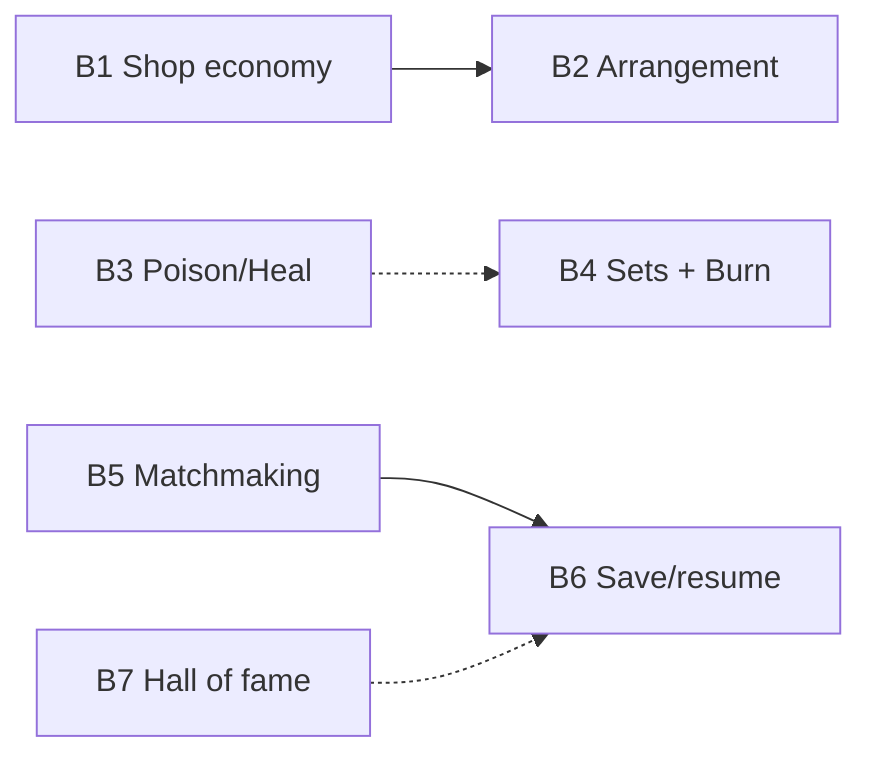

# Plan & workflow
Repo: https://github.com/loonaarc/backpack-brawl

- **Tasks and status** live in [GitHub Issues](https://github.com/loonaarc/backpack-brawl/issues), one issue per requirement. Dependencies between them are set as "blocked by" links on the issues.
- **Each feature's documentation** lives in `docs/features/Bx-<name>.md`, using [the template](features/_TEMPLATE.md): how it works, decisions, values, how we verified it.
- **Cross-cutting qualitative goals** live in [QUALITY.md](QUALITY.md) (#8, both of us).

## Who does what

There's no fixed split. **Assigning yourself to an issue is the claim**: do it before you start, then you own that issue.
Prefer to continue along the same track you're already on (see below), so we rarely edit the same files.

| Track | Issues | Weight |
|---|---|---:|
| A: Shop / backpack | #1 B1 → #2 B2 | 25% |
| B: Battle | #3 B3 → #4 B4 | 35% |
| C: Flow | #5 B5 → #6 B6 | 20% |
| D: Hall of fame | #7 B7 (→ #6) | 20% |

**Fastest way to 60%:** B1 + B5 + B3 + B2 = 50%, then B4 or B7 (+20%).

## Dependencies

Solid arrow = must come first. Dashed arrow = easier if it comes first, but not required. On GitHub, all four are set as "blocked by": #2 ← #1, #4 ← #3, #6 ← #5 and #7.

- **B1 → B2:** both change `Backpack.tsx` and `run.ts`.
- **B3 → B4:** Burn reuses the status-effect mechanism (stacks, tick interval, log event) that B3 introduces.
- **B5 → B6:** what a refresh during a search means depends on how B5 models a search (e.g. a search id).
- **B7 → B6:** "never submit twice" needs a run id, which B6 should also save. Items are saved by id, so B1–B4 don't change the save format.

**Files we both touch, so mention it in the commit message and rebase your branch onto `main` often:** `types.ts`, `ShopPage.tsx`, `rules.ts`, `server/opponents.js` (B3/B4 opponents use the new effects).

## Workflow

1. Assign yourself to the issue. Then `git pull` on `main` and `git switch -c feat/bX-short-name`.
2. Make small commits with meaningful messages that reference the issue, e.g. `feat(shop): add sell action with half refund (#1)`. **Push often**, because the other person can see your branch on GitHub without a merge.
3. Document the implementation of the issue: copy [`docs/features/_TEMPLATE.md`](features/_TEMPLATE.md) to `docs/features/Bx-<name>.md` (e.g. `B1-shop-economy.md`) and fill it in on the same branch. Cover the code path, the decisions you made, the values you chose, and how you verified it. Write it while you work, not afterwards.
4. **Update your branch:** `git fetch` and then `git rebase origin/main`. This puts your commits on top of the latest `main`, so you resolve conflicts on your branch and never on `main`.
5. **Check the combined state:** run `npm run check`, then `git push --force-with-lease`. Force is needed because the rebase rewrote your branch. `--force-with-lease` refuses if someone else pushed to it in the meantime. Wait for the CI run (`.github/workflows/check.yml`, runs automatically on every push) to show ✅ next to the commit or in the Actions tab. **Only merge on ✅.**
6. **Merge:** `git switch main && git pull && git merge --no-ff feat/bX-… -m "Merge B1 shop economy, closes #1"`, then `git push`. If `main` moved since step 4, go back to step 4.
   `--no-ff` keeps the feature as its own merge commit even though the rebase would allow a fast-forward. `closes #1` closes the issue automatically.
   **Only rebase your own feature branch. Never rebase `main`.**
7. If you stop mid-feature, leave a short comment on the issue saying where you stopped and what's next.
8. **Read each other's merged features**, so both of us know all of the code.

## Bugs already in the starter (found while reading the code, verify before fixing)

- **B1:** `buyItem` in `run.ts` doesn't check for a full backpack. `firstFreeSlot` returns `-1`, so the gold is paid and the item disappears.
- **B5:** `searchFailed` in `game.ts` sets the error but leaves `phase` as `"searching"`, so the shop stays locked.
- **B5:** `fightBlocker` only checks for an empty backpack, so "Find opponent" can start a second search while one is running.
- **B5:** `startBattle` doesn't check that we are still in a search for the current round. A late or duplicate response would start a battle anyway.

## Definition of done (per requirement)

- [ ] Rule logic lives in the plain TS modules (`run.ts`, `battle.ts`, `game.ts`, …); components only display state and call those functions
- [ ] The UI explains why an action isn't possible, using the same `…Blocker` function that guards the action itself
- [ ] Vitest tests next to the module; `npm run check` (lint + test + build) is green locally, and the GitHub Actions run on the branch shows ✅
- [ ] Rules panel / tooltips updated where mechanics changed
- [ ] Feature doc written; the other person has read the feature after the merge
